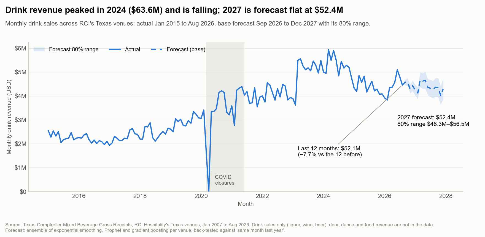
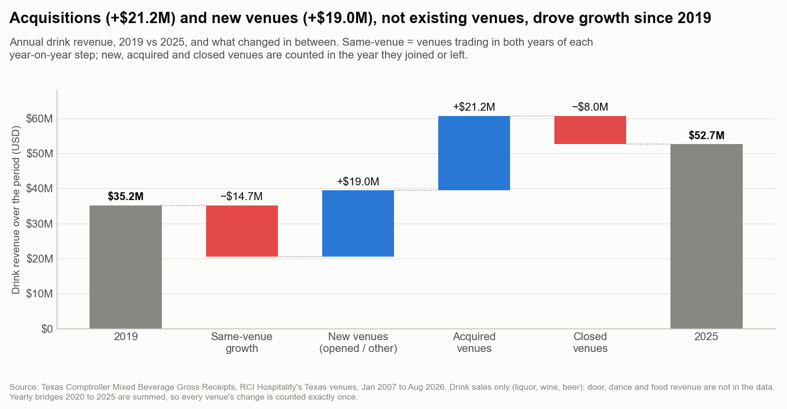
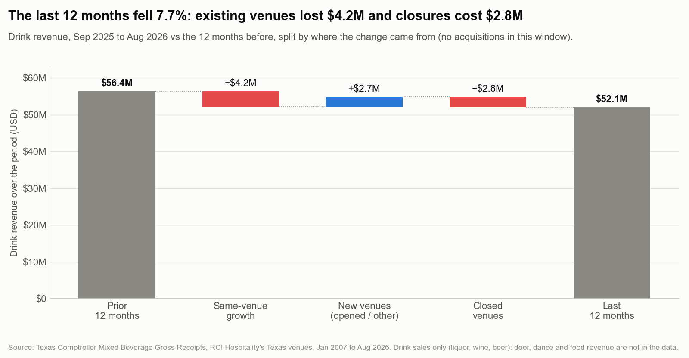
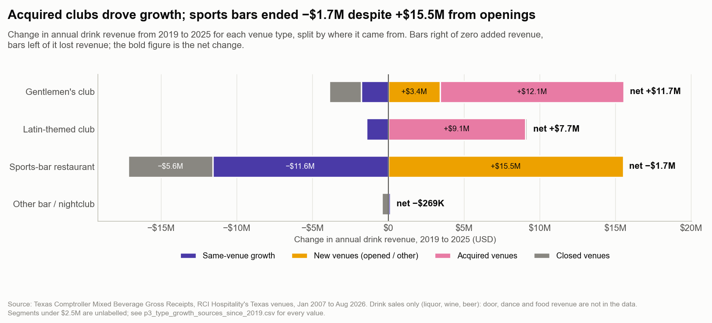
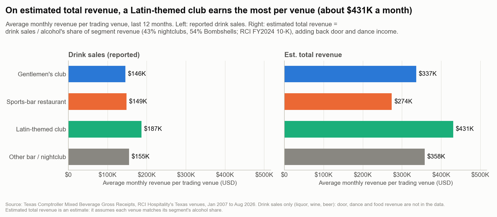
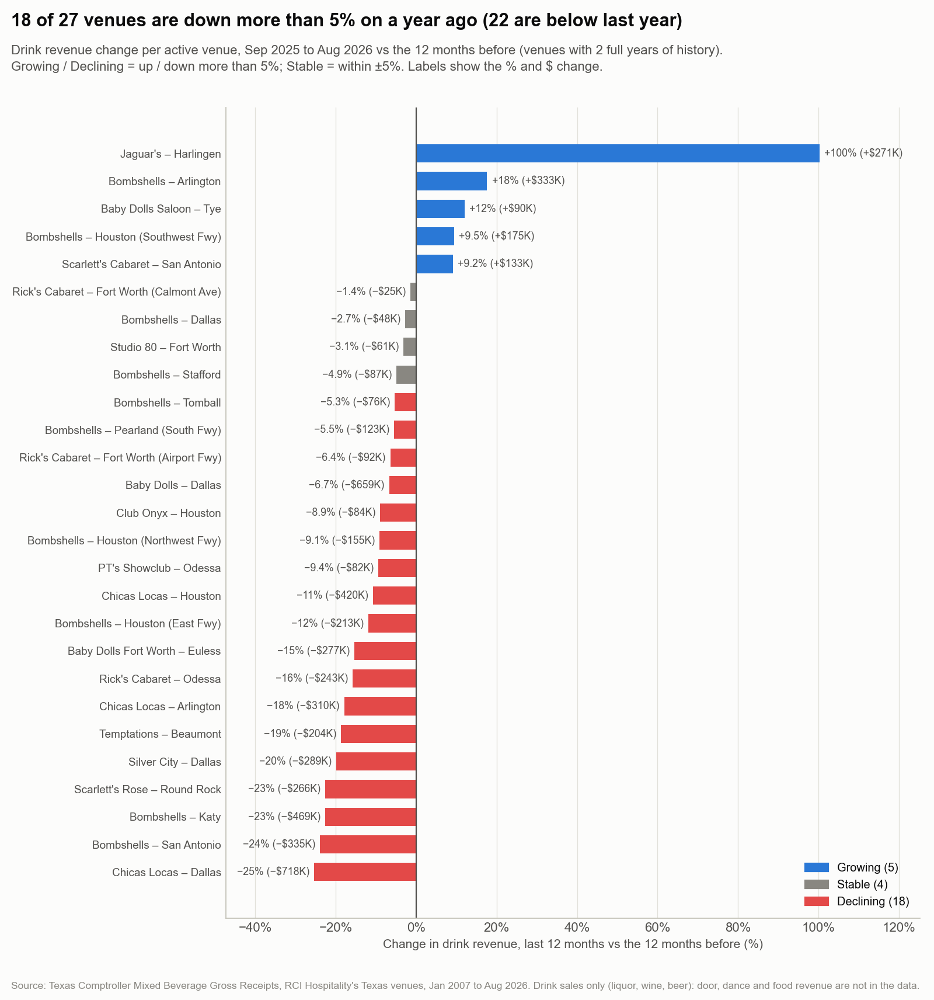
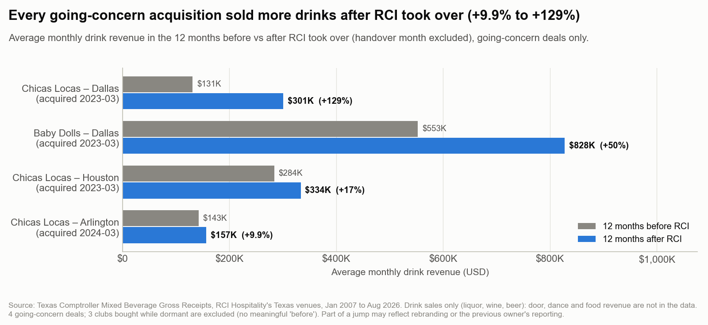
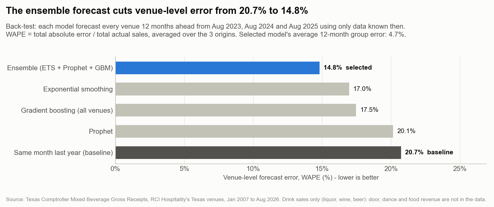
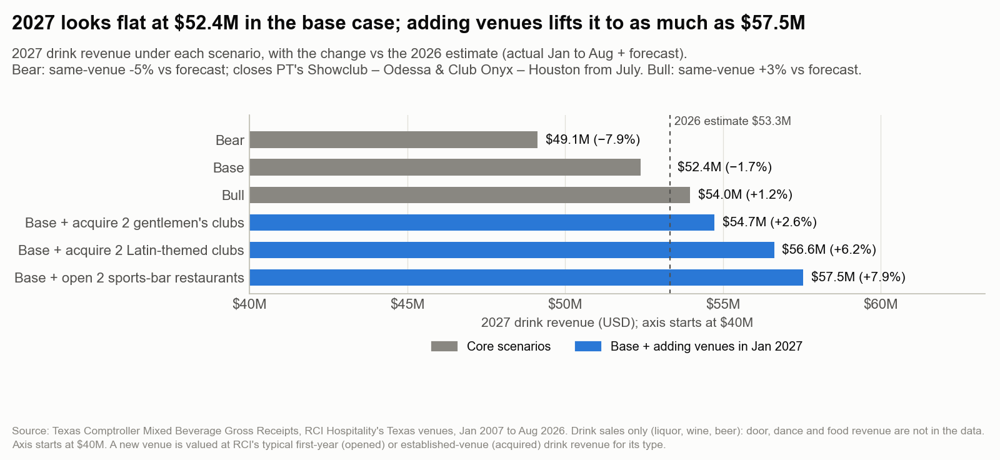

# Multi-Venue Sales & Revenue Forecasting: RCI Hospitality (Texas)

This project analyses nearly 20 years of real, public drink-sales data for the Texas venues of RCI Hospitality, a
listed nightlife and restaurant group. It answers four questions: is the group growing, which venues are growing or
declining, which type of venue drives growth, and what 2027 is likely to look like. Everything, from download to
forecast to charts, is built in Python and reruns with one command.

**Headline findings**
- Drink sales over the last 12 months (Sep 2025 – Aug 2026) were **$52.1M, down 7.7%** on the 12 months before.
- Growth since 2019 came from **buying and opening venues**, not from existing ones. Acquisitions added **+$21.2M** and
  new venues **+$19.0M**. Existing venues lost **−$14.7M** and closures cost **−$8.0M**.
- The **2027 base forecast is $52.4M**, roughly flat. Growth in 2027 depends on adding venues or fixing the decline
  at existing ones.

**Tools:** Python (pandas, scikit-learn, statsmodels, Prophet, matplotlib)
**One-page summary:** [docs/executive_summary.md](docs/executive_summary.md)

---

## The company
**RCI Hospitality Holdings** (NASDAQ: RICK) is a US publicly listed hospitality group based in Houston, Texas. It runs:
- **Gentlemen's clubs**, such as Rick's Cabaret, Baby Dolls and Scarlett's
- **Bombshells**, a chain of sports-bar restaurants
- **Chicas Locas**, Latin-themed clubs

A multi-venue group is a good subject for this kind of analysis. Total sales can grow in four different ways:
existing venues sell more, the group opens new venues, it buys venues, or it closes them. A single total hides which
of these is happening. Management needs to know, because each one leads to a different decision.

## The business questions
1. Is the group's revenue growing or falling, and **why**?
2. Which individual venues are growing, and which are declining?
3. Which **type of venue** has contributed most to growth? What does that suggest about what to **buy or open next**?
4. What will revenue look like in **2027**, under cautious, expected and optimistic assumptions?

## The data
**Source:** Texas Comptroller of Public Accounts, *Mixed Beverage Gross Receipts*
([dataset page](https://data.texas.gov/Government-and-Taxes/Mixed-Beverage-Gross-Receipts/naix-2893),
[API](https://data.texas.gov/resource/naix-2893)). It is public and needs no login.

- **What it is:** every Texas venue licensed to sell mixed drinks must report its sales each month. The file splits
  them into liquor, wine and beer.
- **Period:** January 2007 to August 2026 (the latest complete month).
- **Coverage:** 47 venues that RCI has run in Texas over the period. 29 are still trading and 18 have closed.
- **How RCI's venues were found:** each venue files under a legal company. RCI's companies file from its Houston head
  office address, and the Bombshells companies share a recognisable name. The download keeps only those filings. For
  venues RCI bought, it also keeps the previous owner's filings at the same address, so sales can be compared before
  and after the purchase.
- **Drink sales only.** Door fees (apart from small cover-charge amounts), dance income, food and merchandise are
  not in this data.

Full details, the identification rules and a sanity check against RCI's FY2024 annual report (10-K) are in
[data/1_raw/README.md](data/1_raw/README.md).

## How it was done, step by step
The key idea: **don't just extend the total into the future. Split growth into its drivers first.** Analysts
forecasting a consumer brand split sales into volume, price and product mix. For a group of venues the equivalent is:

> **Change in group sales = same-venue growth + new venues + acquired venues − closed venues**, by venue type

*Same-venue growth* means growth from venues that were open in both periods being compared.

**1. Download the raw data** (`src/01_download_data.py`)
Pulls RCI's filings, plus previous owners' filings for acquired venues, from the Texas open-data API. The raw file is
never edited.
*Why:* a fixed, untouched copy of the source means every later number can be traced and rebuilt.

**2. Clean it** (`src/02_clean.py`)
Builds one row per venue per month. It merges venues that moved within the same building, adds up handover months
where old and new owners both filed, and treats $0 filings as "not trading" rather than "sold nothing". It labels each
venue's type, how it joined RCI (opened or acquired) and whether it is still open.
*Why:* the raw filings describe permits and companies, but the questions are about venues.

**3. Analyse growth** (`src/03_growth_analysis.py`)
Splits every year's change (and the last 12 months) into same-venue, new, acquired and closed venues, by venue type.
It also builds a scorecard for each venue, "ramp-up" curves showing how new venues develop, a before/after comparison
for acquisitions, and seasonality.
*Why:* this shows *where* growth came from, which a total cannot.

**4. Forecast** (`src/04_forecast.py`)
A *forecast* is an estimate of future sales based on past patterns. Each active venue is forecast month by month to
December 2027 using several models. The models are **back-tested**: each one predicts periods that have already
happened, using only the data available at the time, and is scored against what actually happened. The most accurate
approach is used.
*Why:* back-testing proves the model is better than a simple rule of thumb before anyone relies on it.

**5. Build scenarios** (`src/05_scenarios.py`)
Turns the forecast into 2027 scenarios: bear (cautious), base (expected) and bull (optimistic), plus "what if the
group adds two venues of a given type". It also builds a "venue playbook": what a new venue of each type
typically earns in its first three years.
*Why:* a single forecast number hides the risks. Scenarios make the assumptions explicit.

**6. Build the insight tables** (`src/06_insight_tables.py`)
Writes one clean CSV per business question to `3_insight_tables/`, with every number, label and growth direction
already calculated. `_index.csv` lists each table and the question it answers. The script then checks that the
tables add up: actual sales, the growth bridge, the 12-month total and the 2027 forecast all reconcile with each
other.
*Why:* each chart then only has to plot, and every figure in a chart can be traced to a row in a table.

**7. Draw the charts** (`src/07_figures.py`)
Draws a labelled chart for each insight from those tables and saves them to `4_python_visuals/`. The key charts are
copied to `images/` for this README. Chart titles and captions are written from the data, so they stay correct after
a fresh download.
*Why:* a chart with a plain-English takeaway title is quicker to act on than a table of numbers.

## Key findings

**1. Drink sales peaked in 2024 and are falling; 2027 is forecast roughly flat.**
Annual drink sales peaked at $63.6M in 2024. The last 12 months came to $52.1M (−7.7%). The base forecast for 2027
is $52.4M, with an approximate 80% range of $48.3M–$56.5M: the forecast expects 2027 to land in this range about
8 times out of 10. The range is based on how far past back-tested forecasts were off, widened for months further
ahead.



**2. Growth since 2019 was bought and built, not grown.**
Sales rose from $35.2M in 2019 to $52.7M in 2025. Acquisitions added +$21.2M and new venues +$19.0M. Venues that
were already open lost −$14.7M, and closures took away −$8.0M.



**3. The latest drop comes mostly from existing venues.**
Sales fell from $56.4M to $52.1M over the last 12 months. Existing venues lost −$4.2M (−8.0% same-venue growth) and
closures −$2.8M. New venues added +$2.7M. There were no acquisitions in this window.



**4. Acquired clubs drove growth; sports bars shrank despite many openings.**
From 2019 to 2025, gentlemen's clubs grew +$11.7M (acquisitions +$12.1M) and Latin-themed clubs +$7.7M
(acquisitions +$9.1M). Sports-bar restaurants gained +$15.5M from new openings but ended **−$1.7M**, because existing
sports bars lost −$11.6M and closures cost −$5.6M.



**5. Counting non-drink income, a Latin-themed club earns the most per venue.**
On drink sales alone the types look similar ($146K–$187K a month per venue). Clubs also earn door and dance income,
so the project estimates total revenue from RCI's reported alcohol share. On that estimate a Latin-themed club brings
in about $431K a month, a gentlemen's club $337K and a sports bar $274K.



**6. Most venues are selling less than a year ago.**
18 of the 27 active venues with two full years of history are down more than 5%, and 22 are below last year.
The largest dollar falls are Chicas Locas Dallas (−$718K), Baby Dolls Dallas (−$659K) and Bombshells Katy (−$469K).
Baby Dolls Dallas alone is 18% of the active venues' total drink sales.



**7. Every acquired going concern sold more after RCI took over.**
All four venues bought while still trading had higher average monthly drink sales in their first 12 months under RCI:
+9.9% to +129%. This is a small sample, and part of the jump may reflect rebranding or how the previous owner reported.



## Forecast and how accurate it is

### How the forecast is made, step by step
1. **Start with clean monthly sales.** Each venue gets one line of numbers: its drink sales for every month RCI owned
   it. Months from before RCI bought a venue are left out, because the previous owner may have run it differently.
2. **Remove the COVID period.** March 2020 to June 2021 is taken out, because lockdowns aren't normal behaviour and
   would confuse the models.
3. **Three "forecasters" each predict every month to December 2027, for every venue:**
   - **Exponential smoothing (ETS)** looks at one venue on its own, using data from July 2021 onwards. It learns the
     venue's current level, whether it is drifting up or down (dampened so it doesn't run away), and its usual busy
     and quiet months.
   - **Prophet** (a forecasting tool from Meta) also looks at one venue on its own, but uses history since 2015, with
     COVID removed. It learns the long-term trend and the yearly pattern.
   - **Gradient boosting (GBM)** is the machine-learning model. One model learns from **all venues at once**, using
     history since 2012. It is trained on thousands of past examples like: *"This venue averaged $Y a month over the
     last 12 months, the same month last year was $Z, the last 3 months were up on last year, it's a 4-year-old
     sports bar, and the prediction is 6 months ahead. What actually happened?"* From these it learns patterns such
     as "sports bars fade after opening" and "March is strong", then applies them to today's numbers.
4. **Average the three (the "ensemble").** For each venue and month, the forecast is the simple average of the three.
   For example, if ETS says $150K, Prophet $170K and gradient boosting $160K, the forecast is $160K. Each model makes
   different kinds of mistakes, and averaging cancels much of that out.
5. **Safety checks.** If exponential smoothing produces something absurd (more than 3× the venue's best month), it
   is replaced by "same month last year". No forecast can go below $0.
6. **Brand-new venues are handled differently.** A venue with less than 2 years of history doesn't have enough data
   for the models, so it follows the typical path for new venues of its type. For example, a new sports bar opens
   high, then settles about 36% lower by month 18.
7. **Add it all up.** Venue forecasts are summed to give each venue type and the whole group: **$52.4M for 2027**.
8. **Add an uncertainty range.** The back-test (below) shows how far off forecasts typically were. That gives the
   80% range of **$48.3M–$56.5M**: 8 times out of 10, the real 2027 figure should land inside it. The range widens
   the further ahead the forecast goes.
9. **Feed the scenarios.** The base scenario is this forecast. Bear and bull adjust it, and the "what if the group
   adds venues" scenarios add typical new venues on top.

### Why these models, and not others
- **SVM (support vector machines):** not built for time series. It needs a lot of hand-made features and has no
  advantage over gradient boosting here.
- **Deep learning (LSTM / neural networks):** needs far more data. There are only about 5 years of monthly
  post-COVID data per venue for about 27 venues, so it would overfit, meaning it would memorise the past instead of
  learning patterns.
- **ARIMA:** similar to exponential smoothing but less reliable on short, gappy series, so ETS covers that role.
- **A different "best" model for each venue:** tempting, but it would make the accuracy look better than it really
  is. One approach is used for all venues.
- **One model on its own:** every single model had a higher venue-level error in testing than the average of three.

### How it was tested
**The back-test.** Each model was asked to forecast 12 months ahead from three past starting points (Aug 2023,
Aug 2024 and Aug 2025), using only the data available at the time. Its forecasts were then compared with what actually
happened. Accuracy is scored on the venues still trading for all 12 months after each test date. The comparison
point is the simplest possible rule: **"sales will be the same as the same month last year"**.
A model is only useful if it beats that.

**How error is measured.** *WAPE* (weighted average percentage error) is the average error: the total of all the
misses, in dollars, divided by total actual sales. Lower is better.

| Model | Venue-level error (WAPE) | Group monthly error (WAPE) | Group 12-month total: bias | Group 12-month total: average error |
|---|---|---|---|---|
| **Ensemble (ETS + Prophet + GBM), selected** | **14.8%** | **7.6%** | **+3.4%** | **4.7%** |
| Exponential smoothing | 17.0% | 8.1% | +4.3% | 4.3% |
| Gradient boosting (all venues) | 17.5% | 9.1% | +5.0% | 7.8% |
| Prophet | 20.1% | 7.7% | +0.8% | 4.1% |
| Same month last year (baseline) | 20.7% | 13.4% | +11.5% | 11.5% |

- **Venue-level error:** how far off each venue's monthly forecast was. The selected model cut it from 20.7% to 14.8%.
- **Bias:** whether the 12-month group total was too high (+) or too low (−) on average. Every model
  over-forecast on average (the baseline by 11.5%).
- **Average error on the 12-month total:** the size of the miss on the full-year group total, ignoring direction.
- The ensemble was chosen because it had the lowest venue-level error: about 28% lower than the baseline. On the
  12-month group total its average error (4.7%) is similar to, not better than, exponential smoothing (4.3%) and
  Prophet (4.1%).



## 2027 scenarios
The 2026 estimate is **$53.3M** (actual Jan–Aug plus forecast for the rest of the year).

| Scenario | 2027 drink sales | vs 2026 estimate | Assumption, in plain words |
|---|---|---|---|
| Bear | $49.1M | −7.9% | Existing venues sell 5% less than forecast, and the two weakest declining venues (PT's Showclub Odessa and Club Onyx Houston) close in July |
| **Base** | **$52.4M** | **−1.7%** | The model forecast for today's venues |
| Bull | $54.0M | +1.2% | Existing venues sell 3% more than forecast |
| Base + acquire 2 gentlemen's clubs | $54.7M | +2.6% | Each performs like a typical established gentlemen's club |
| Base + acquire 2 Latin-themed clubs | $56.6M | +6.2% | Each performs like a typical established Latin-themed club |
| Base + open 2 sports-bar restaurants | $57.5M | +7.9% | Each performs like a typical first-year Bombshells |

**Caution: the sports-bar "honeymoon".** New sports bars start strong and then settle. RCI's 15 openings had median
first-year drink sales of $2.58M, falling to $1.96M in year 2 (−24%). So the "open 2 sports bars" line flatters the
long-term picture. The acquisition lines rest on only 1–3 past deals per type.



## What this means for decision-making
These are what the data suggests, not firm conclusions (see Limitations).

1. **Buying established, trading clubs has added more than building sports bars.** Acquired clubs drove most of the
   growth since 2019, and every going-concern deal sold more after the takeover. But the acquired Latin-themed clubs
   are now down 17% on a same-venue basis, so a plan to hold the gains after year one matters.
2. **Fix the decline at existing venues first.** It cost −$4.2M in the last 12 months, more than any other factor.
   Start with the largest dollar falls: Chicas Locas Dallas, Baby Dolls Dallas and Bombshells Katy.
3. **Judge new sports bars on year-2 sales, not opening months.** The first-year "honeymoon" fades by about a quarter.
4. **Watch concentration.** One venue, Baby Dolls Dallas, is 18% of the active venues' drink sales and is down 6.7%.

Caveats: the data covers drinks only, Texas only, and has no costs or purchase prices. It shows which options added
revenue, not which gave the best return on investment.

## All charts and tables
This README shows 9 of the 16 charts. The full set is in [4_python_visuals/](4_python_visuals/), grouped the same way
as the insight tables:

| Topic | Charts | Tables (in `3_insight_tables/`) |
|---|---|---|
| Group overview | 01 trend and forecast, 02 growth sources since 2019, 03 last-12-months bridge, 05 revenue by venue type | `p1_*` |
| Venue performance | 08 venue growth, 09 top 10 venues, 12 seasonality, 13 drinks mix | `p2_*` |
| Venue types & acquisitions | 04 change by venue type, 06 revenue share by venue type, 07 revenue per venue, 10 ramp-up curves, 11 acquisitions before vs after | `p3_*` |
| 2027 outlook | 14 forecast accuracy, 15 scenarios, 16 forecast by venue type | `p4_*` |

`p2_venue_scorecard.csv` has one row per venue (revenue, growth, trend, rank and 2027 forecast) and works as a
stand-alone venue report.

## Project structure
```
Sales-And-Revenue-Forecasting/
├── data/
│   ├── 1_raw/                  raw Comptroller filings, never edited, plus the data README
│   ├── 2_clean/                one row per venue per month, and one row per venue
│   └── intermediate/           working tables passed between the analysis scripts
├── 3_insight_tables/           one CSV per business question, read by the charts; _index.csv lists them
├── 4_python_visuals/           one labelled PNG chart per insight
├── images/                     the key charts used in this README, listed in _list.txt
├── src/                        the pipeline scripts, 01 to 07, plus common.py (shared settings)
├── config/                     venue_types.csv: each venue's name, brand and type
├── docs/                       executive_summary.md (one-page summary)
├── run_all.py                  runs the whole pipeline in order
└── requirements.txt            Python packages needed
```

## Reproduce the results
Requires Python 3.

```bash
pip install -r requirements.txt
python run_all.py              # rebuild everything from the raw file already in data/1_raw/
python run_all.py --download   # download the latest filings first, then rebuild everything
```

All dates move forward automatically after a fresh download: the forecast always runs to December of the following
year.

## Limitations
- **Drinks only.** Door fees (apart from small cover-charge amounts), dance income, food and merchandise are not in
  the data.
- **Estimated total revenue is an estimate.** It divides drink sales by alcohol's share of revenue in RCI's FY2024
  10-K: 43.3% for nightclubs and 54.3% for Bombshells. It assumes every venue matches its segment's average.
- **Texas only.** RCI also has venues in other states.
- **Monthly data.** No weekly or daily detail.
- **No costs, profit or purchase prices.** The project measures revenue, not return on investment.
- **Small acquisition sample.** Only 4 going-concern acquisitions, so treat those findings as directional.
- **Some venue types are inferred.** The type of 6 of the 47 venues is inferred from the name or filing company,
  not confirmed.
- **Price vs volume can't be separated.** The data has dollar sales only, not the number of drinks or their prices.

## Tools used
- **Python:** pandas, NumPy, requests, scikit-learn, statsmodels, Prophet, matplotlib
